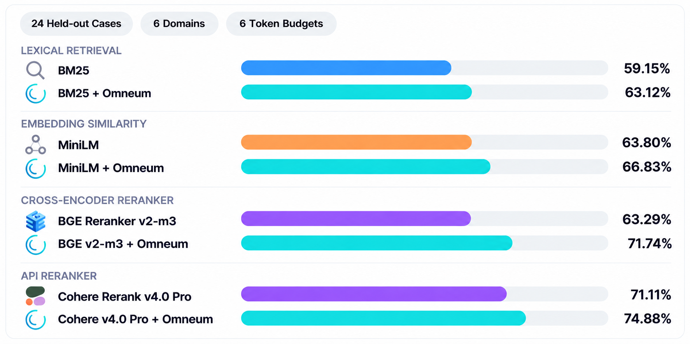

<!-- mcp-name: io.github.cole-h06/omneum -->
# Omneum

<p align="center">
  
</p>

<p align="center">
  Provenance-aware context control plane for AI agents.
</p>

<p align="center">
  <a href="https://github.com/cole-h06/omneum/actions/workflows/CI.yml">
    
  </a>
  <a href="https://pypi.org/project/omneum/">
    
  </a>
  
  <a href="https://github.com/cole-h06/omneum/blob/main/LICENSE">
    
  </a>
</p>

Omneum is an open-source context control plane for AI agents, built to optimize the evidence entering an LLM's context window.

Agents accumulate context from retrieval, tools, memory, and previous sessions, but longer context windows don't guarantee better reasoning. Context rot can slowly degrade downstream answer accuracy even when the relevant information has already been retrieved.

## Why Omneum?

- **Provenance-aware graph inference:** Iteratively computes source reliability and claim support across a bipartite graph, accounting for shared evidence origins and dependencies between sources.

- **Context reconstruction:** Selects original retrieved passages based on question relevance and incremental claim coverage within a token budget.

- **Text-blind evaluation:** Evaluates structured observations without reading source text strings or invoking an LLM judge.

- **Local by default:** Persists your agents' observations across sessions in a [Context Graph](https://github.com/cole-h06/omneum/blob/main/docs/context-graph.md), backed by SQLite or PostgreSQL.

## Quick Start

Install Omneum:

```bash
pip install omneum
```

Run the context reconstruction demo:

```bash
git clone https://github.com/cole-h06/omneum.git
cd omneum
python -m examples.context_quality_demo.before_after
```

**Five retrieved chunks, four distinct claims, 80-unit context budget.**

Compare retrieval-order packing with Omneum's claim-coverage selection under the same context budget.

| Metric | Raw RAG | Omneum |
|---|---:|---:|
| Chunks retained | 3 | 2 |
| Claim coverage | 2/4 | 4/4 |
| Budget used | 75/80 | 51/80 |

Packing chunks in retrieval order consumes 75 units while covering only two claims. Omneum retains two original chunks covering all four, using **32% less context capacity**.

The demo measures its budget with the SDK's word/punctuation counter.

[Example source →](https://github.com/cole-h06/omneum/tree/main/examples/context_quality_demo)

[Set up the MCP server →](#mcp-installation)

## How Omneum Works

### Graph Inference & Context Selection

Omneum uses a graph-based mathematical analysis, calculated from `Observation` objects, to estimate the structural reliability of sources and the support for claims found in retrieved context.

Importantly, this analysis does not naively assume every source has derived its information independently. The same information often propagates across multiple sources. Without dependency tracking, five observations from different sources can be difficult to distinguish from five reports derived from the same upstream source.

For example, consider:

```text
Source A:    Acme's 2025 annual report
Claim:       Acme reported $4.2 billion in revenue for 2025.

Source B:    Financial article reporting the same claim
Claim:       Acme reported $4.2 billion in revenue for 2025.
Upstream:    Acme's 2025 annual report
```

How much support should that claim receive? That depends partly on the reliability of the sources reporting it. But how do we determine the reliability of the sources? By looking at the claims they support.

This definition seems circular, and it is. Nonetheless, it provides a well-defined notion of reliability that helps distinguish strongly supported context from weakly supported context.

Of course claim-level scores are only useful for context selection if they can be mapped back to chunks. To bridge this gap, Omneum stores a claim-to-chunk mapping: each chunk retains its original text and `chunk_id`, while its associated `claim_ids` reference the claims evaluated in the graph. A chunk can contain multiple claims, and the same claim can appear across multiple chunks. This allows the algorithm to associate claim support with the actual passages competing for space in the context window.

But selecting context is not simply a matter of ranking chunks by their individual scores. Omneum derives chunk utility from the claims associated with each passage, then ranks chunks to fill the model's window under a limited token budget. When a nonempty `question` is supplied, finalized claim contributions are weighted by deterministic, local lexical relevance over the original passage text. Repeated evidence from the same inferred source cluster earns only an improvement over its best selected relevance. Without a question, Omneum keeps its question-blind claim-coverage selection. Selected passages are reconstructed from their original text.

The selected passages are then reconstructed from their original text into the context passed to the LLM. The analysis itself never needs to read that text because it operates exclusively on structured relationships between sources and claims.

[Experiments and research →](https://github.com/cole-h06/omneum/tree/main/research)

### Integration

Omneum runs between retrieval and generation. The Python SDK accepts retrieved chunks and relevance scores from the calling retrieval pipeline, or computes relevance locally using BM25 or MiniLM when explicitly enabled.

```text
Retrieval / tools
        │
        ▼
┌───────────────────────────────────────────┐
│ ContextMapper / Observation input         │
│                                           │
│ Source, claim and provenance mapping      │
│ Structured Observation construction       │
└─────────────────────┬─────────────────────┘
                      │ Structured observations
                      ▼
┌───────────────────────────────────────────┐
│ Python SDK · prepare_context()            │
│                                           │
│ Retrieved chunks and relevance scores     │
│ Query conditioning / candidate discovery  │
│ Original text retained locally            │
└─────────────────────┬─────────────────────┘
                      │ Structured observations
                      ▼
┌───────────────────────────────────────────┐
│ Omneum evaluator                          │
│                                           │
│ Provenance-aware graph inference          │
│ Dependency-adjusted claim support         │
│ No original source text required          │
└─────────────────────┬─────────────────────┘
                      │ Graph evaluation
                      ▼
┌───────────────────────────────────────────┐
│ Python SDK                                │
│                                           │
│ Claim-to-chunk score mapping              │
│ Question-weighted claim support           │
│ Marginal claim coverage                   │
│ Token-budget enforcement                  │
│ Original text reconstruction              │
└─────────────────────┬─────────────────────┘
                      │ Reconstructed context
                      ▼
                  Agent / LLM
```

`client.prepare_context()` uses Omneum's provenance-aware graph inference to evaluate source reliability and claim support, accounting for dependencies between sources. The SDK uses those results to rank and select retrieved passages within the token budget, then reconstructs their original text for the model.

The prepared context is returned in `result["context"]`, with selected passages in `result["chunks"]` and evaluation scores in `result["evaluation"]`.

[Architecture →](https://github.com/cole-h06/omneum/blob/main/docs/architecture.md)

## MCP Installation

**Note:** Omneum supports Python 3.11–3.14 on macOS and Ubuntu. The Python SDK is the currently supported client library.

**Supported Platforms:**

| Platform | Supported |
| --- | :---: |
| macOS (Apple Silicon / arm64) | ✅ |
| macOS (Intel / x86_64) | ✅ |
| Linux (Ubuntu 22.04+ / x86_64) | ✅ |

### 1. Install the evaluator

Run the installer to configure the local evaluator:

```bash
omneum install
```

Run `omneum install` from your normal login account. Don't run the command with `sudo`.

The installer runs unprivileged while it downloads and verifies the evaluator release. The daemon version is pinned to the installed Python package version. For example, Omneum `1.0.3` only accepts daemon assets from `v1.0.3`; it doesn't resolve `latest` or fall back to another release.

The archive is verified against the release `SHA256SUMS` before installation. A missing checksum, mismatched digest, unexpected archive entry, link, or path traversal stops the install before anything from the archive runs.

Administrator access is requested only when installing machine-level service files. On Ubuntu, this includes the managed runtime under:

```text
/opt/omneum
```

and public client configuration at:

```text
/etc/omneum/config.toml
```

The evaluator runs under a dedicated service identity, isolating its VOPRF private key from the login account and MCP server process. macOS uses `launchd`; Ubuntu uses systemd.

`omneum-server` exposes Omneum's MCP tools over stdio and communicates with the locally installed evaluator service. The installer finishes by sending a VOPRF request through that path and verifying the response against the configured public key. A running service alone does not count as a successful installation.

See [`docs/guides/installation.md`](https://github.com/cole-h06/omneum/blob/main/docs/guides/installation.md) for service accounts, sockets, installed paths, custom endpoints, and failure handling.

### 2. Connect your MCP client

Add Omneum to your MCP configuration:

```json
{
  "mcpServers": {
    "omneum": {
      "command": "omneum-server"
    }
  }
}
```

Restart the MCP client. It launches `omneum-server` over stdio and exposes Omneum's tools to your agent.

If the executable isn't found, locate it with `command -v omneum-server` and use the returned absolute path as `command`.

### 3. Verify

Ask your agent to call Omneum's `ping` tool. A successful connection returns:

```json
{
  "status": "ok"
}
```

## Context Preparation

Omneum evaluates structured observations, selects retrieved chunks under a token budget, and reconstructs the selected text for the downstream LLM. The evaluator computes dependency-adjusted claim support, while the Python SDK handles chunk selection and reconstruction.

### 1. Map retrieved context

In this example, the FAQ derives its audit retention claim from the security policy. The upstream dependency is recorded through `upstream_sources`.

```python
from datetime import datetime, timezone

from omneum import ContextMapper, Source
from omneum.information import SourceReference
from omneum.context_selection import claim_id

now = datetime.now(timezone.utc)
policy_url = "https://example.com/security-policy"

records = [
    {
        "id": "obs-policy",
        "url": policy_url,
        "attribute": "audit_retention_days",
        "value": 90,
        "upstream": [],
        "text": "Audit logs are retained for 90 days.",
    },
    {
        "id": "obs-faq",
        "url": "https://example.com/faq",
        "attribute": "audit_retention_days",
        "value": 90,
        "upstream": [
            SourceReference(kind="web_document", identifier=policy_url)
        ],
        "text": "Audit logs are retained for 90 days.",
    },
    {
        "id": "obs-incident",
        "url": "https://example.com/incident-report",
        "attribute": "incident_notification_hours",
        "value": 24,
        "upstream": [],
        "text": "Security incidents are reported within 24 hours.",
    },
]

mapper = ContextMapper(
    source=lambda r: Source(kind="web_document", identifier=r["url"]),
    entity_namespace=lambda r: "security",
    entity=lambda r: "acme",
    attribute="attribute",
    value="value",
    observation_id="id",
    observed_at=lambda r: now,
    upstream_sources="upstream",
)

observations = [mapper.map(record) for record in records]

chunks = [
    {
        "chunk_id": record["id"],
        "claim_ids": [claim_id(observation.claim)],
        "raw_text": record["text"],
    }
    for record, observation in zip(records, observations)
]
```

`ContextMapper` maps the records into assertion observations. The original text stays in the chunk mapping, accessible through the associated claim IDs. Only the structured observations are sent to the MCP evaluator.

### 2. Reconstruct context

Pass the mapped observations and chunks to `prepare_context()`. The dependency estimator is configured to use upstream lineage.

```python
import asyncio

from omneum import DependencyEstimatorConfig, OmneumClientConfig, open_stdio_client
from omneum.mcp import StdioServerParameters

estimator = DependencyEstimatorConfig(
    upstream_weight=1.0,
    citation_weight=0.0,
    assertion_lineage_weight=0.0,
    ownership_weight=0.0,
    temporal_weight=0.0,
    graph_weight=0.0,
    temporal_window_seconds=7200.0,
)

async def main():
    config = OmneumClientConfig.from_local_deployment()
    server = StdioServerParameters(command="omneum-server")

    async with open_stdio_client(config, server) as client:
        result = await client.prepare_context(
            observations,
            chunks,
            estimator=estimator,
            token_budget=100,
        )

    print(result["context"])
    print(result["selection"]["claim_coverage"])

if __name__ == "__main__":
    asyncio.run(main())
```

Save as `prepare_context.py` and run:

```bash
python prepare_context.py
```

The returned JSON contains the reconstructed context at `result["context"]`. Graph scores are available in `result["evaluation"]`, so your agent can inspect the result before invoking the model.

See [`examples/context_quality_demo/`](https://github.com/cole-h06/omneum/tree/main/examples/context_quality_demo) for a comparison with retrieval-order packing.

### 3. Agent Control Flow

An agent orchestrator can use Omneum's claim support scores to control execution after retrieval. In LangGraph, a conditional edge can send the workflow back to a retrieval node when the evidence falls below a configured threshold.

```python
def route_context(result):
    evaluation = result["evaluation"]

    if (
        not evaluation["converged"]
        or evaluation["max_claim_support"] is None
        or evaluation["max_claim_support"] < 0.30
    ):
        return "retrieve"

    return "generate"
```

The `retrieve` branch can run another search before the agent attempts generation. Once the routing condition passes, the model receives `result["context"]`.

The threshold is an example. A workflow that needs support for particular claims can inspect their individual scores in `evaluation["claim_support"]`.

[Python SDK →](https://github.com/cole-h06/omneum/blob/main/docs/sdk.md)

## Integrations

Use the [Python SDK](https://github.com/cole-h06/omneum/blob/main/docs/sdk.md) and [ContextMapper](https://github.com/cole-h06/omneum/blob/main/docs/context-mapper.md) to add Omneum to your agent.

Framework examples:

- [LangGraph](https://github.com/cole-h06/omneum/tree/main/examples/langgraph/)
- [LlamaIndex](https://github.com/cole-h06/omneum/tree/main/examples/llamaindex/)
- [CrewAI](https://github.com/cole-h06/omneum/tree/main/examples/crewai/)
- [OpenAI Agents SDK](https://github.com/cole-h06/omneum/tree/main/examples/openai_agents/)
- [Microsoft Agent Framework](https://github.com/cole-h06/omneum/tree/main/examples/microsoft/)
- [Google ADK](https://github.com/cole-h06/omneum/tree/main/examples/google_adk/)

For a complete framework-independent workflow, see the
[enterprise policy example](https://github.com/cole-h06/omneum/tree/main/examples/enterprise/).

### Optional: Omneum Network (Closed Beta)

Omneum runs locally by default. Network contribution is opt-in and allows participating deployments to contribute observations to the shared Omneum Context Graph without uploading raw context.

Contributions use privacy-preserving linkage through an RFC 9497 VOPRF. The shared graph can accumulate source and claim relationships across deployments while keeping the underlying text local.

Network contribution is disabled by default and is not required for local evaluation. Hosted Network enrollment is currently limited to approved beta participants.

See [Enable Network contribution (MCP)](https://github.com/cole-h06/omneum/blob/main/docs/guides/configuration.md#mcp-configuration) for setup instructions or [How Network contribution works](https://github.com/cole-h06/omneum/blob/main/docs/context-graph.md#omneum-network) for the protocol details.

## Data Model & Context Preparation

Omneum evaluates retrieved context through a source–claim graph. Claims identify factual assertions within the retrieved passages, while observations preserve where those assertions originated. The graph's evaluation scores inform which original chunks are selected for the LLM's context window.

### Observations

Observations record information encountered during retrieval. The first supported type, an assertion observation, connects a claim to its source and preserves the provenance available at the time it was encountered.

```python
Observation(
    observation_id="obs-1",
    source=source,
    claim=claim,
    observed_at=datetime.now(timezone.utc),
)
```

An assertion can appear across multiple retrieved passages without being treated as independent evidence each time. Observations preserve these source relationships for graph inference. Conflicting assertions also remain distinct, retaining the evidence originally reported by each source.

[Observations docs →](https://github.com/cole-h06/omneum/blob/main/docs/architecture.md#observation)

### Sources

Sources identify where retrieved evidence originated. Each source has a `kind` and canonical `identifier`, allowing Omneum to recognize the same source across observations.

```python
Source(
    kind="web_document",
    identifier="https://example.com/acme-filing",
)
```

Source identity matters when multiple passages reference the same fact. Omneum uses these relationships during dependency estimation so repeated evidence does not receive the same weight as independent support.

[Sources docs →](https://github.com/cole-h06/omneum/blob/main/docs/architecture.md#source)

### Claims

Claims represent factual assertions identified within retrieved context. Omneum maps claims across source passages to evaluate their support and determine which chunks contribute useful evidence to the model's context.

Each claim is represented by an `entity_namespace`, `entity`, `attribute`, and `value`.

```python
Claim(
    entity_namespace="company",
    entity="acme",
    attribute="fy2025_gross_revenue",
    value=4_200_000_000,
)
```

Multiple passages can reference the same claim. Their source relationships are accounted for during graph inference, allowing context selection to prioritize additional claim coverage within the token budget.

[Claims docs →](https://github.com/cole-h06/omneum/blob/main/docs/architecture.md#claim)

### Source Dependence

Retrieved passages may repeat assertions from the same underlying source. Omneum estimates source dependence using available provenance signals, including upstream references and assertion lineage.

These dependencies affect how much support each source contributes to a claim. A passage repeating an earlier report can still be selected when it adds useful context, but the repeated assertion does not receive the weight of independent evidence.

[Source dependence docs →](https://github.com/cole-h06/omneum/blob/main/docs/architecture.md#dependency-estimation)

### Context Mapping

`ContextMapper` maps structured retrieval records into Omneum's observation model. Claim fields and source metadata are extracted from the records supplied by the integrating pipeline.

The SDK maintains a claim-to-chunk mapping. Each chunk retains its `chunk_id` and `raw_text`, while `claim_ids` reference the claims represented in that passage.

This mapping allows graph inference to operate on structured observations while keeping the original text available for context reconstruction.

[ContextMapper docs →](https://github.com/cole-h06/omneum/blob/main/docs/context-mapper.md)

### Context Selection & Reconstruction

After graph inference, Omneum uses claim support to select retrieved chunks within a context budget.

Selection accounts for claim coverage across the candidate passages. A chunk's utility depends on the additional evidence it contributes to the selected context, including claims already covered by other chunks.

`prepare_context()` reconstructs the selected passages from their original text. The returned `context` string is ready to be included in the next LLM request.

The selection budget applies to the retrieved evidence. The consuming agent remains responsible for accounting for the rest of the model's input.

### Evaluation Results

`prepare_context()` returns a dictionary containing reconstructed context, selected chunks, graph evaluation results, and selection metadata.

```python
result = await client.prepare_context(
    observations,
    chunks,
    estimator=estimator,
    token_budget=2048,
)

context = result["context"]
claim_scores = result["evaluation"]["claim_support"]
selected_chunks = result["chunks"]
```

The `evaluation` object exposes source reliability and claim support scores from graph inference. The `selection` object records token-budget usage, while `packed_chunk_ids` identifies the chunks included in the reconstructed context.

An agent orchestrator can inspect the evaluation before invoking the LLM. Conditional routing can trigger another retrieval pass when the available evidence does not meet the workflow's requirements.

[Python SDK and response schema →](https://github.com/cole-h06/omneum/blob/main/docs/sdk.md)

## Performance & Accuracy

The [Cross-Domain Context Curation Benchmark](https://github.com/cole-h06/omneum/blob/main/benchmarks/leaderboard.md) evaluates 13 context-selection configurations on **24 synthetic cases across six agentic domains**, using six Qwen-token budgets from 64 to 256. Each configuration receives the same candidate passages within a case. Results are macro-averaged across cases and budgets.

### Retrieval & Reranking

Omneum improved selection precision across all four evaluated integrations—BM25, MiniLM embeddings, BGE Reranker v2-m3, and Cohere Rerank v4.0 Pro, while reducing the number of tokens used.



| Configuration | Precision ↑ | Recall ↑ | Evidence ↑ | Claims ↑ | Origins ↑ | Qwen Tokens ↓ |
|---|---:|---:|---:|---:|---:|---:|
| Original-Order RAG | 43.33% | 42.75% | 43.08% | 58.51% | 60.32% | 136.87 |
| BM25 | 59.15% | 55.76% | 55.79% | 66.15% | 71.05% | 136.18 |
| **BM25 + Omneum** | **63.12%** | 46.86% | 46.90% | 66.22% | 69.16% | **111.60** |
| MiniLM Embeddings | 63.80% | 59.13% | 58.86% | 68.47% | 70.94% | 136.31 |
| **MiniLM + Omneum** | **66.83%** | 49.08% | 50.14% | 69.74% | 68.50% | **111.08** |
| BGE Reranker v2-m3 | 63.29% | 59.19% | 58.84% | 68.75% | 71.42% | 136.47 |
| **BGE + Omneum** | **71.74%** | 54.76% | 55.26% | **75.36%** | **75.21%** | **116.74** |
| Cohere Rerank v4.0 Pro | 71.11% | 64.43% | 64.39% | 72.29% | 75.20% | 136.72 |
| **Cohere + Omneum** | **74.88%** | 54.91% | 56.20% | 72.99% | 72.86% | **112.68** |
| Omneum Standalone | 61.55% | 52.65% | 53.42% | **75.85%** | **75.52%** | 129.27 |

Across the four integrations, Omneum increased aggregate selection precision by **3.02–8.44 percentage points** and reduced mean reconstructed-context token usage by **14.46–18.51%**.

BGE + Omneum delivered the largest precision gain, improving from **63.29% to 71.74%**, alongside an increase in claim coverage from **68.75% to 75.36%**. Its precision improvement was **+8.44 percentage points** (95% paired bootstrap CI: **+2.19 to +15.37 pp**), based on 50,000 whole-case resamples.

Cohere + Omneum achieved the highest precision among the evaluated Omneum integrations at **74.88%**, using **17.58% fewer context tokens** than standalone Cohere.

The integrations prioritize a smaller set of supporting passages, increasing precision at the expense of aggregate recall and evidence retention. The [full leaderboard](https://github.com/cole-h06/omneum/blob/main/benchmarks/leaderboard.md) includes the paired comparisons and confidence intervals.

### Frontier LLM Judges

The benchmark also evaluates Claude Sonnet 5.5, GPT-6 Astra, and Gemini 3.8 Flash as passage-ranking judges. Each judge ranks the fixed candidate pool before token-budgeted packing. Omneum performs selection locally through `prepare_context()` without an additional frontier-model judge call.

| Configuration | Precision ↑ | Recall ↑ | Evidence ↑ | Claims ↑ | Origins ↑ | Qwen Tokens ↓ |
|---|---:|---:|---:|---:|---:|---:|
| Claude Sonnet 5.5 | **85.69%** | **75.85%** | **76.49%** | 81.05% | 82.89% | 136.41 |
| GPT-6 Astra | 85.14% | 75.33% | 76.18% | **81.48%** | **83.50%** | 136.49 |
| Gemini 3.8 Flash | 83.81% | 74.81% | 75.33% | 80.12% | 81.27% | 136.52 |
| Omneum Standalone | 61.55% | 52.65% | 53.42% | 75.85% | 75.52% | 129.27 |
| BGE + Omneum | 71.74% | 54.76% | 55.26% | 75.36% | 75.21% | 116.74 |
| Cohere + Omneum | 74.88% | 54.91% | 56.20% | 72.99% | 72.86% | **112.68** |

Frontier judges achieved higher aggregate selection quality. Claude Sonnet 5.5 led selection precision at **85.69%**, while GPT-6 Astra achieved the highest claim coverage (**81.48%**) and root-origin coverage (**83.50%**).

Omneum's integrations operate without frontier judge inference, with smaller reconstructed contexts in the recorded comparisons.

### Selection Latency & Cost

Omneum's median local selection latency ranged from **194.86 ms to 207.79 ms** across standalone and hybrid configurations.

| Configuration | Local Selection p50 ↓ | Local Selection p95 ↓ |
|---|---:|---:|
| Omneum Standalone | **194.86 ms** | 451.87 ms |
| BM25 + Omneum | 207.79 ms | 461.25 ms |
| MiniLM + Omneum | 203.84 ms | 465.36 ms |
| BGE + Omneum | 200.63 ms | **430.51 ms** |
| Cohere + Omneum | 206.89 ms | 480.37 ms |

Timing begins with relevance scores and structured observations already available. External ranking inference and observation preparation are excluded.

The recorded frontier-judge response medians were **1.844 s** for Claude Sonnet 5.5, **2.034 s** for GPT-6 Astra, and **2.033 s** for Gemini 3.8 Flash. Provider response time and Omneum's local selection time have different measurement boundaries.


| Frontier Judge | Estimated Ranking Inference Cost |
|---|---:|
| Claude Sonnet 5.5 | $0.113996 |
| GPT-6 Astra | $0.281080 |
| Gemini 3.8 Flash | $0.025231 |
| **Total** | **$0.420307** |

These are aggregate estimates from the saved frontier-ranking calls, using recorded token counts and pricing assumptions. They exclude Cohere API charges and local computation. No downstream answer generation was executed in this benchmark.

**Detailed evaluations:** [Methodology](https://github.com/cole-h06/omneum/blob/main/benchmarks/README.md) · [Full Leaderboard](https://github.com/cole-h06/omneum/blob/main/benchmarks/leaderboard.md) · [Coding Agents](https://github.com/cole-h06/omneum/blob/main/benchmarks/coding.md) · [Enterprise RAG](https://github.com/cole-h06/omneum/blob/main/benchmarks/enterprise-rag.md) · [Research & Analysis](https://github.com/cole-h06/omneum/blob/main/benchmarks/research.md) · [Multi-Agent Systems](https://github.com/cole-h06/omneum/blob/main/benchmarks/multi-agent.md) · [Data Analytics](https://github.com/cole-h06/omneum/blob/main/benchmarks/analytics.md) · [Support & Operations](https://github.com/cole-h06/omneum/blob/main/benchmarks/support.md)

## Production

Omneum uses SQLite as its default local storage backend. PostgreSQL is supported for deployments that use an external database.

| Component | Implementation |
|---|---|
| **MCP server** | Local `omneum-server` process |
| **Evaluator** | Managed local daemon |
| **Local database** | SQLite |
| **Graph model** | Relational source, claim, observation, and dependency tables |
| **External database** | PostgreSQL |
| **Graph extension** | Apache AGE |
| **Service manager** | `launchd` on macOS; systemd on Ubuntu |
| **Cryptography** | RFC 9497 VOPRF, Ristretto255-SHA512 |

Local installations create `omneum.db` automatically:

```text
macOS
~/Library/Application Support/Omneum/omneum.db

Linux
~/.local/share/omneum/omneum.db
```

For a new default graph with unsafe data-directory ancestors, Omneum uses
`~/.omneum/data/omneum.db`. Existing graphs and explicit paths are never
silently relocated; shared directory permissions are preserved.

PostgreSQL can be configured for deployments that use an external database. Apache AGE provides the graph projection for PostgreSQL deployments.

See [`docs/storage.md`](https://github.com/cole-h06/omneum/blob/main/docs/storage.md) for the storage schema and deployment options.

## Security & Privacy

The Python SDK retains original text chunks locally for context selection and reconstruction. The evaluator processes structured observations and provenance metadata without accessing source text. The MCP server, evaluator daemon, and SQLite database run locally.

| Component | Boundary |
|---|---|
| **Context** | Original chunks remain available to the SDK for selection and reconstruction |
| **Context graph** | Stored in local `omneum.db` |
| **VOPRF private key** | Held by the evaluator daemon |
| **MCP process** | Cannot read the evaluator's private key |
| **Source payloads** | Not required in the graph |
| **Omneum Network** | Optional contribution through the ingestion API |

Omneum persists the local context graph across MCP sessions.

Local persistence and Omneum Network contribution are configured independently.

| Option | Behavior |
|---|---|
| **Local persistence** | Writes observations to `omneum.db` |
| **Network contribution** | Sends pseudonymous observations to the Omneum Network through the ingestion API |

See [Omneum Network](https://github.com/cole-h06/omneum/blob/main/docs/context-graph.md#omneum-network) for Network contribution and [Local Persistence](https://github.com/cole-h06/omneum/blob/main/docs/context-graph.md#local-persistence) for Context Graph storage.

## Documentation

- [Python SDK](https://github.com/cole-h06/omneum/blob/main/docs/sdk.md)
- [MCP Protocol](https://github.com/cole-h06/omneum/blob/main/docs/protocol.md)
- [Context Graph](https://github.com/cole-h06/omneum/blob/main/docs/context-graph.md)
- [Configuration](https://github.com/cole-h06/omneum/blob/main/docs/guides/configuration.md)
- [Benchmarks](https://github.com/cole-h06/omneum/blob/main/benchmarks/leaderboard.md)

## Contributing

Contributions are welcome. See [CONTRIBUTING.md](https://github.com/cole-h06/omneum/blob/main/CONTRIBUTING.md).

If you find a security issue, please follow the private reporting process in [SECURITY.md](https://github.com/cole-h06/omneum/blob/main/SECURITY.md) instead of opening a public issue.

## License

Omneum is open source under the [MIT License](https://github.com/cole-h06/omneum/blob/main/LICENSE).