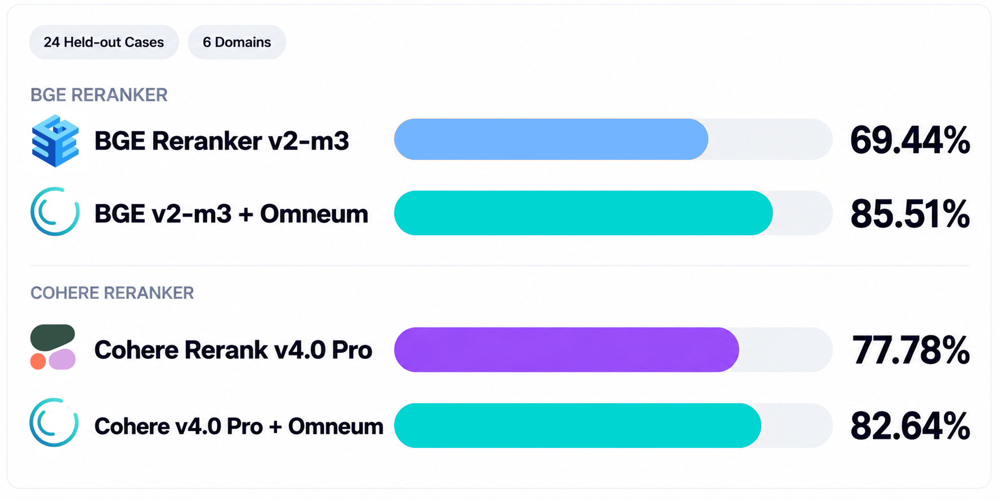
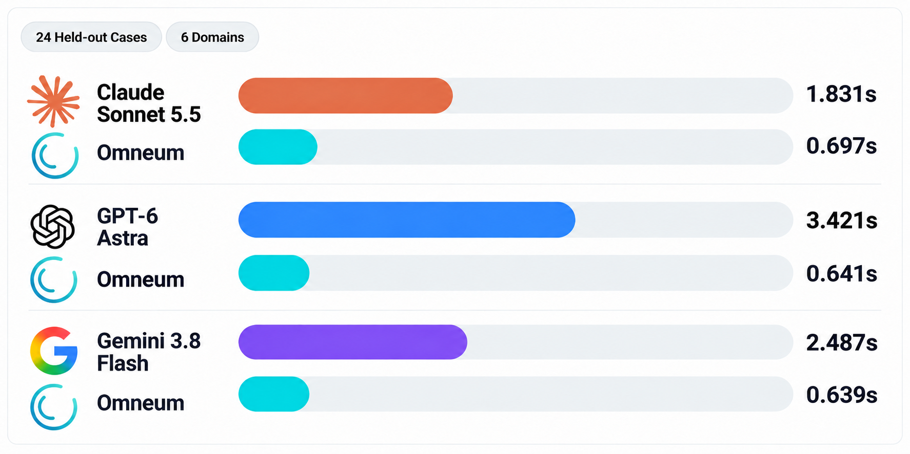

# What is Omneum

<p align="center">
  
</p>

Omneum: an open-source context evaluator for AI agents.

Agents routinely assemble context from many different sources — a RAG pipeline, web search, APIs, databases, files, memory systems, other agents — but stuffing dozens of raw chunks into a single context window can leave the model working through a mess of information that was never organized for it.

Most agents focus on retrieving more context. Omneum is focused on making sure the context reaching the model is clean and reliable.

## Why Omneum and how it works

Modern agent pipelines use several different techniques to decide what context should reach a model:

**Semantic similarity (Vector DBs).** The piece of text that *looks* closest to the prompt wins.

**Semantic reranking.** Retrieved context is reordered based on how relevant it is to the query.

**LLM-as-a-Judge.** An LLM reads the retrieved context and is instructed to evaluate it against a set of instructions.

These techniques can be highly effective at selecting context, but relevance is only one dimension of context quality.

Chunks can still hold conflicting or stale information. Multiple retrieved chunks might not be deduplicated or appear independent despite sharing an upstream source. This contributes to context bloat: low-quality information consumes context-window capacity that could otherwise be used for higher quality information.

Omneum addresses many of these limitations: it uses a graph-based mathematical analysis to model  the relationships between claims and their supporting sources. Importantly, this analysis does not naively assume every source has derived its information independently. The same information often propagates across multiple sources. Without dependency tracking, an agent cannot distinguish five independent observations from the same information repeated five times.

Agent pipelines already handle structured metadata alongside retrieved context. Omneum uses available provenance and lineage metadata to estimate source dependencies, then incorporates those estimates into its calculation of source reliability and claim support scores.

These scores are computed without interpreting the semantic meaning of the context. For instance, when considering a claim such as:

**“Acme reported $4.2 billion in revenue in 2025.”**

Its support score depends on the reliability of the sources supporting it. In turn, those sources receive reliability from the claims they support.

This definition seems circular, and it is. Nonetheless, it yields a well-defined notion of reliability that helps distinguish strongly supported context from weakly supported context.

Omneum uses **BRAID**, its open-source algorithm, to compute these reliability and support scores. [Explore the algorithm and research →](https://github.com/cole-h06/braid/tree/main)

## Where Omneum fits

Omneum runs locally as a [Model Context Protocol (MCP)](https://modelcontextprotocol.io/) server. It adds a lightweight post-retrieval evaluation layer to your existing retrieval or ranking stack; no inference request, no extra model call.

**Retrieval / tools → Reranking (optional) → Omneum evaluation → agent control flow → LLM**

Omneum returns context-quality signals; your agent makes evidence-aware decisions throughout its workflow.

[Architecture and design →](docs/architecture.md)

## Quick Start

**Note:** This tutorial assumes Python 3.11–3.14. SDKs for other languages are not currently supported.

### 1. Install

**Supported Platforms:**

| Platform | Supported |
| --- | :---: |
| macOS (Apple Silicon / arm64) | ✅ |
| macOS (Intel / x86_64) | ✅ |
| Linux (Ubuntu 22.04+ / x86_64) | ✅ |

Install Omneum using pip:

```bash
pip install omneum
```

### 2. Set up Omneum

Run the installer to configure the local evaluator:

```bash
omneum install
```

Run `omneum install` from your normal login account. Don't run the command with `sudo`.

The installer runs unprivileged while it downloads and verifies the evaluator release. The daemon version is pinned to the installed Python package version. For example, Omneum `1.0.3` only accepts daemon assets from `v1.0.3`; it doesn't resolve `latest` or fall back to another release.

The archive is verified against the release `SHA256SUMS` before installation. A missing checksum, mismatched digest, unexpected archive entry, link, or path traversal stops the install before anything from the archive runs.

Administrator access is requested only when installing machine-level service files. On Ubuntu, this includes the managed runtime under:

```text
/opt/omneum
```

and public client configuration at:

```text
/etc/omneum/config.toml
```

The evaluator runs as a system service because its VOPRF private key is isolated from the login account and MCP process. On macOS it runs under `launchd`; on Ubuntu it runs under systemd with a separate service identity.

`omneum-server` connects MCP clients to the installed local service. The installer finishes by sending a VOPRF request through that path and verifying the response against the configured public key. A running service alone does not count as a successful installation.

See [`docs/guides/installation.md`](docs/guides/installation.md) for service accounts, sockets, installed paths, custom endpoints, and failure handling.

### 3. Connect your agent

Add Omneum to your MCP client configuration:

```json
{
  "mcpServers": {
    "omneum": {
      "command": "omneum-server"
    }
  }
}
```

Restart your MCP client to expose Omneum's tools to your agent.

If your MCP client cannot find `omneum-server`, set `command` to the absolute path returned by `command -v omneum-server`.

### 4. Verify the connection

Ask your agent to call Omneum's `ping` tool. A successful response returns `"status": "ok"`, confirming that your agent can reach the Omneum MCP server.

## Running an Evaluation

Evaluate retrieved context using Omneum's Python SDK and local MCP server.

### 1. Map retrieved context

Use `ContextMapper` to map retrieved records into Omneum observations. The example uses three sources, two of which reference the same upstream document.

```python
import asyncio
from datetime import datetime, timezone

from mcp import StdioServerParameters
from omneum import (
    ContextMapper,
    DependencyEstimatorConfig,
    OmneumClientConfig,
    Source,
    open_stdio_client,
)

now = datetime.now(timezone.utc)

records = [
    {
        "id": "obs-1",
        "url": "https://example.com/report-a",
        "value": 4_200_000_000,
        "upstream": ["https://example.com/filing"],
        "observed_at": now,
    },
    {
        "id": "obs-2",
        "url": "https://example.org/report-b",
        "value": 4_200_000_000,
        "upstream": ["https://example.com/filing"],
        "observed_at": now,
    },
    {
        "id": "obs-3",
        "url": "https://example.net/report-c",
        "value": 4_200_000_000,
        "upstream": [],
        "observed_at": now,
    },
]

mapper = ContextMapper(
    source=lambda r: Source(kind="web_document", identifier=r["url"]),
    entity_namespace=lambda r: "company",
    entity=lambda r: "acme",
    attribute=lambda r: "fy2025_gross_revenue",
    value="value",
    observation_id="id",
    observed_at="observed_at",
    upstream_sources=lambda r: [
        {"kind": "web_document", "identifier": url}
        for url in r["upstream"]
    ],
)
```

The SDK handles canonicalization. See [Canonicalization](docs/canonicalization.md).

### 2. Evaluate context

Connect to `omneum-server` and call `evaluate_mapped()` with a dependency estimator:

```python
estimator = DependencyEstimatorConfig(
    upstream_weight=0.25,
    citation_weight=0.20,
    assertion_lineage_weight=0.20,
    ownership_weight=0.10,
    temporal_weight=0.10,
    graph_weight=0.15,
    retrieval_weight=0.0,
    temporal_window_seconds=7200.0,
)

async def main():
    config = OmneumClientConfig.from_local_deployment()
    server = StdioServerParameters(command="omneum-server")

    async with open_stdio_client(config, server=server) as client:
        evaluation = await client.evaluate_mapped(
            records,
            mapper,
            estimator=estimator,
        )
        print(evaluation.explanation)


asyncio.run(main())
```

Save both Python blocks in `evaluate.py`, then run:

```bash
python evaluate.py
```

### 3. Evaluation results

`evaluation.explanation` formats the evaluation result for inspection.

```text
Omneum Evaluation
Evaluation latency: 10.6 ms

Fy2025 gross revenue

  4200000000
  Support: 0.67
  Supporting sources: 3
  Estimated independent support: 2.00
  Dependency signal coverage: 0.25

  Explanation:
    3 sources support this claim, with an estimated 2.00 independent sources. The available dependency signals indicate that some supporting sources are related.
```

Three sources report the same value, but two reference a shared upstream document. Omneum identifies this dependency and estimates 2.00 independent supporting sources instead of treating all three as independent evidence.

An agent can use this result to trigger additional retrieval or route execution back to a verification step before generating a response.

See [Evaluation schema](docs/architecture.md#evaluation-results) for result fields.

## Integrations

Use the [Python SDK](docs/sdk.md) and [ContextMapper](docs/context-mapper.md) to add Omneum to your agent.

Framework examples:

- [LangGraph](examples/langgraph/)
- [LlamaIndex](examples/llamaindex/)
- [CrewAI](examples/crewai/)
- [OpenAI Agents SDK](examples/openai_agents/)
- [Microsoft Agent Framework](examples/microsoft/)
- [Google ADK](examples/google_adk/)

For a complete framework-independent workflow, see the
[enterprise policy example](examples/enterprise/).

### Optional: Contribute to the Omneum Network

Omneum runs locally by default. You can opt in to contribute observations to the shared Omneum Context Graph without uploading raw context.

Network contributions help build a shared evidence base across agent deployments, extending the Context Graph beyond any single installation.

Contributions use privacy-preserving cryptographic linkage via an RFC 9497 VOPRF. Network contribution is disabled by default. Local evaluation works without it.

See [Enable Network contribution (MCP)](docs/guides/configuration.md#mcp-configuration) to get started, or [How Network contribution works](docs/context-graph.md#omneum-network) for technical details.

## Data Model & Evaluation

### Observations

Context is more than a collection of text chunks. Omneum represents information encountered by an agent as **observations** — immutable records that preserve structured data and its provenance. The first supported type, an assertion observation, records a claim, its source, and the metadata needed to evaluate it.

```python
Observation(
    observation_id="obs-1",
    source=source,
    claim=claim,
    observed_at=datetime.now(timezone.utc),
)
```

Observations retain available provenance and metadata, including source ownership, timestamps, citations, upstream source relationships, and assertion lineage. Multiple assertion observations can support the same claim or report conflicting values without being merged or overwritten. Observations are not generated judgments about what is true: they preserve the evidence as reported.

[Observations docs →](docs/architecture.md#observation)

### Sources

Sources identify where an assertion originated. Each source has a `kind` and a canonical `identifier` for recognizing the same source across multiple observations. Sources can represent web documents, databases, internal services, or other information providers.

```python
Source(
    kind="web_document",
    identifier="https://example.com/acme-filing",
)
```

[Sources docs →](docs/architecture.md#source)

### Claims

Claims represent specific assertions extracted from retrieved context, such as text chunks and tool outputs. Each claim consists of an `entity_namespace`, `entity`, `attribute`, and `value`. An integrating agent or retrieval pipeline extracts these fields, and `ContextMapper` maps them into Omneum's data model.

```python
Claim(
    entity_namespace="company",
    entity="acme",
    attribute="fy2025_gross_revenue",
    value=4_200_000_000,
)
```

[Claims docs →](docs/architecture.md#claim)

### Source Dependence

Multiple sources can report the same claim without providing independent support. Omneum estimates source dependence from upstream lineage, citations, assertion lineage, shared ownership, timestamps, and graph structure.

Estimated source dependencies adjust the contribution of related sources when calculating independent support for each claim.

[Source dependence docs →](docs/architecture.md#dependency-estimation)

### ContextMapper

`ContextMapper` maps structured data from agent and retrieval pipelines into Omneum's observation model. It defines how source identifiers, claim fields, timestamps, and provenance metadata are read from existing records.

[ContextMapper docs →](docs/context-mapper.md)

### ContextEvaluation

`ContextEvaluation` returns source reliability and claim support scores adjusted for source dependence, alongside conflict and provenance information.

```python
evaluation = await client.evaluate_mapped(
    records,
    mapper,
    estimator=estimator,
)
print(evaluation.explanation)
```

[ContextEvaluation docs →](docs/architecture.md#evaluation-results)

## Performance & Accuracy

Evaluated on **24 held-out cases across six domains**: coding agents, enterprise RAG, research and analysis agents, multi-agent systems, data analytics agents, and support and operations agents.

### Semantic Rerankers

Measures how Omneum improves evidence selection when combined with semantic rerankers across diverse agent workflows.



| Configuration | Precision ↑ | Recall ↑ | Answer Accuracy ↑ | Selection p50 ↓ | E2E p50 ↓ | Generator Tokens ↓ | Generator Cost ↓ |
|---|---:|---:|---:|---:|---:|---:|---:|
| BGE Reranker v2-m3 | 69.44% | 47.46% | 91.67% | 201 ms | 2.467s | 11,941 | $0.074618 |
| BGE + Omneum | **85.51%** | **59.31%** | 87.50% | 660 ms | 3.020s | 11,595 | **$0.070662** |
| Cohere Rerank v4.0 Pro | 77.78% | 53.99% | 87.50% | 151 ms | 2.634s | 11,577 | $0.071242 |
| Cohere + Omneum | **82.64%** | **55.72%** | 79.17% | 624 ms | 3.176s | 11,535 | **$0.070654** |

*Costs reflect estimated downstream generator API usage only; reranker API charges and local compute are excluded. Omneum improves selection precision and recall in both comparisons.*

### Frontier LLM Judges

Each LLM judge is evaluated alongside Omneum under the same model-specific benchmark configuration.



| Configuration | Precision ↑ | Recall ↑ | Answer Accuracy ↑ | Selection p50 ↓ | E2E p50 ↓ | Generator Tokens ↓ | Generator Cost ↓ |
|---|---:|---:|---:|---:|---:|---:|---:|
| BGE + Claude Sonnet 5.5 Judge | **92.36%** | **65.24%** | **95.83%** | 1.831s | 4.165 s | **11,356** | **$0.068208** |
| BGE + Omneum | 86.11% | 59.34% | 91.67% | **0.697 s** | **3.141 s** | 11,811 | $0.072822 |
| BGE + GPT-6 Astra Judge | **92.78%** | **65.45%** | **92.50%** | 3.421s | 5.849 s | **111,247** | **$0.658998** |
| BGE + Omneum | 86.11% | 59.34% | 91.67% | **0.641 s** | **2.983s** | 115,119 | $0.698310 |
| BGE + Gemini 3.8 Flash Judge | **94.24%** | **66.18%** | **95.42%** | 6.826s | 9.274 s | **112,349** | **$0.669282** |
| BGE + Omneum | 86.11% | 59.34% | 91.67% | **0.639 s** | **3.130 s** | 115,535 | $0.702470 |

*Costs reflect estimated downstream generator API usage only; LLM judge inference costs and local compute are excluded. Omneum achieves competitive selection quality and downstream answer accuracy against frontier LLM judges, with 2.6–10.7× lower selection latency and no additional LLM inference step.*

**Detailed evaluations:** [Methodology](benchmarks/README.md) · [Coding Agents](benchmarks/coding.md) · [Enterprise RAG](benchmarks/enterprise-rag.md) · [Research Agents](benchmarks/research.md) · [Multi-Agent Systems](benchmarks/multi-agent.md) · [Data Analytics](benchmarks/analytics.md) · [Support Operations](benchmarks/support.md)

## Production

Omneum uses SQLite as its default local storage backend. PostgreSQL is supported for deployments that use an external database.

| Component | Implementation |
|---|---|
| **MCP server** | Local `omneum-server` process |
| **Evaluator** | Managed local daemon |
| **Local database** | SQLite |
| **Graph model** | Relational source, claim, observation, and dependency tables |
| **External database** | PostgreSQL |
| **Graph extension** | Apache AGE |
| **Service manager** | `launchd` on macOS; systemd on Ubuntu |
| **Cryptography** | RFC 9497 VOPRF, Ristretto255-SHA512 |

Local installations create `context.db` automatically:

```text
macOS
~/Library/Application Support/Omneum/context.db

Linux
~/.local/share/omneum/context.db
```

For a new default graph with unsafe data-directory ancestors, Omneum uses
`~/.omneum/data/context.db`. Existing graphs and explicit paths are never
silently relocated; shared directory permissions are preserved.

PostgreSQL can be configured for deployments that use an external database. Apache AGE provides the graph projection for PostgreSQL deployments.

See [`docs/storage.md`](docs/storage.md) for the storage schema and deployment options.

## Security & Privacy

Omneum evaluates context locally. `omneum-server`, the evaluator daemon, and `context.db` run within the local environment.

| Component | Boundary |
|---|---|
| **Context** | Passed to the local evaluation path |
| **Context graph** | Stored in local `context.db` |
| **VOPRF private key** | Held by the evaluator daemon |
| **MCP process** | Cannot read the evaluator's private key |
| **Source payloads** | Not required in the graph |
| **Omneum Network** | Optional contribution through the ingestion API |

Omneum persists the local context graph across MCP sessions.

```text
application data
      │
      ▼
  omneum-server
      │
      ├── evaluator daemon
      │
      └── context.db
```

Local persistence and Omneum Network contribution are configured independently.

| Option | Behavior |
|---|---|
| **Local persistence** | Writes observations to `context.db` |
| **Network contribution** | Sends pseudonymous observations to the Omneum Network through the ingestion API |

See [Omneum Network](docs/context-graph.md#omneum-network) for Network contribution and [Local Persistence](docs/context-graph.md#local-persistence) for Context Graph storage.

## External Evaluations

External evaluations are published with the test inputs and Omneum outputs in [`evaluations/`](evaluations/).

**SearchTS.** SearchTS 0.13.0 returned the same Go 1.22 claim from `thenewstack.io` through `curl_cffi` and `go.dev` through `stealth-browser`. Omneum received the original `final_url` and `fetched_at` values for both captures. The evaluation returned `2.00` estimated independent support, pairwise dependency `0.0000`, and dependency-signal coverage `0.25`. [Results →](evaluations/searchts/)

**Bastra Recall.** Recall ran Omneum 1.0.3 `dependency-estimator-v4` against a 30-memory synthetic harness. Four memories sharing one upstream source collapsed to `1.0` effective independent support; three independent sources remained at `3.0`. A temporal-only sweep moved continuously from `2.5` effective sources at identical timestamps to `3.0` at 48 hours. The evaluation also exposed an open lineage-chain case where `v1 → v2 → v3 → v4` produces `1.6` rather than `1.0` because dependency is currently computed only across direct lineage edges. [Results →](evaluations/bastra-recall/)

## Contributing

Contributions are welcome. See [CONTRIBUTING.md](CONTRIBUTING.md).

If you find a security issue, please follow the private reporting process in [SECURITY.md](SECURITY.md) instead of opening a public issue.

## License

Omneum is open source under the [MIT License](LICENSE).