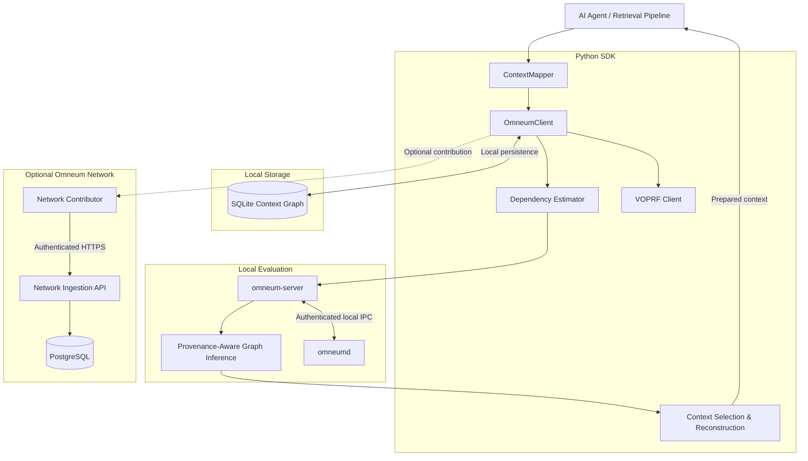

# Architecture Overview

Omneum is a text-blind context control plane for AI agents and RAG pipelines. Its provenance-aware graph inference iteratively computes source reliability and claim support, accounting for dependencies as evidence propagates across a bipartite graph. `OmneumClient.prepare_context()` uses these scores to select retrieved passages under a token budget and reconstruct their original text for the LLM's context window.

## System Overview



`ContextMapper` maps retrieval records into typed observations. `OmneumClient` coordinates dependency estimation and graph evaluation, then uses the resulting claim-support scores for context selection and reconstruction. `omneum-server` executes graph inference and forwards blinded VOPRF requests to `omneumd`.

SQLite persists the local Context Graph. The optional Network contributor sends authorized records through the Network Ingestion API to PostgreSQL.

## Core Modules

| Module | Responsibility | Key Components |
|--------|----------------|----------------|
| **Client** | Python evaluation and context preparation | `OmneumClient`, `OmneumClientConfig`, `open_stdio_client()` |
| **Mapping** | Retrieval records to structured observations | `ContextMapper`, `Source`, `Claim`, `Observation` |
| **Dependency Estimation** | Pairwise source dependency analysis | `DependencyEstimatorConfig`, `DependencySignal` |
| **Evaluation** | Provenance-aware graph inference | `omneum-server`, MCP evaluation tools |
| **Context Selection** | Chunk utility scoring, claim coverage, token-budgeted packing | `OmneumClient.prepare_context()`, `omneum.context_selection` |
| **Reconstruction** | Original-text assembly and token accounting | `raw_text`, `packed_chunk_ids`, `count_tokens` |
| **VOPRF** | Privacy-preserving identifier linkage | SDK VOPRF client, `omneumd` |
| **Storage** | Local Context Graph and execution history | SQLite, `omneum/storage/` |
| **Network** | Optional contribution and ingestion | Contributor, Network API, PostgreSQL |
| **Research** | Evaluation telemetry | `omneum.research_telemetry` |

## Evaluation Pipeline

`OmneumClient.prepare_context()` coordinates provenance-aware graph inference and context preparation. It accepts typed `Observation` records and retrieval chunks containing `chunk_id`, `raw_text`, and `claim_ids`. Each chunk retains its original text for reconstruction after selection.

### Evaluating Context

```text
Retrieval Chunks → ContextMapper → Dependency Estimation → VOPRF Linkage → Provenance-Aware Graph Inference → Context Selection → Reconstruction → Prepared Context
```

1. **Observation Mapping**: `ContextMapper.map_many()` converts retrieval records into `Observation` objects. Each chunk references canonical claim identifiers generated by `omneum.context_selection.claim_id()`.
2. **Dependency Estimation**: The SDK computes pairwise source dependencies from provenance signals, including upstream references, citations, assertion lineage, ownership, and source modification timestamps.
3. **VOPRF Linkage**: The SDK blinds canonical source and claim identifiers. `omneum-server` forwards blinded elements to `omneumd` and returns the evaluated elements and proofs.
4. **Graph Evaluation**: `omneum-server` evaluates the bipartite source–claim graph and returns source reliability, claim support, and convergence diagnostics.
5. **Context Selection**: `prepare_context()` combines claim-support scores with marginal claim coverage, optional query relevance, and chunk token costs. The selector packs chunks under `token_budget`.
6. **Reconstruction**: The SDK assembles the selected `raw_text` passages in final rendering order. `result["context"]` contains the reconstructed payload.

`evaluate_context()` exposes the graph evaluation operation independently of context selection. `prepare_context()` executes the complete preparation path and returns both the prepared context and evaluation diagnostics.

### Python SDK

The SDK connects to the MCP server using `open_stdio_client()`.

```python
from omneum.mcp import StdioServerParameters
from omneum import (
    DependencyEstimatorConfig,
    OmneumClientConfig,
    open_stdio_client,
)

config = OmneumClientConfig.from_local_deployment()
server = StdioServerParameters(command="omneum-server")

estimator = DependencyEstimatorConfig(
    upstream_weight=0.25,
    citation_weight=0.20,
    assertion_lineage_weight=0.20,
    ownership_weight=0.10,
    temporal_weight=0.10,
    graph_weight=0.15,
    temporal_window_seconds=7200.0,
)

async with open_stdio_client(config, server) as client:
    evaluation = await client.evaluate_context(
        observations,
        estimator=estimator,
    )
```

`evaluate_context()` accepts a sequence of `Observation` objects. For existing retrieval records, `evaluate_mapped()` accepts a `ContextMapper` and maps the records before evaluation.

For context preparation, pass mapped observations and their original retrieval chunks to `prepare_context()`:

```python
result = await client.prepare_context(
    observations,
    chunks,
    estimator=estimator,
    token_budget=4096,
)
```

`result["context"]` contains the reconstructed text. `result["selection"]` reports token usage and claim coverage. `result["evaluation"]` contains graph evaluation results.

See [Python SDK](sdk.md) and [ContextMapper](context-mapper.md).

## Data Model

Omneum uses three primary types for structured context: `Source`, `Claim`, and `Observation`.

| Type | Responsibility | Key Fields |
|------|----------------|------------|
| **Source** | Information provider | `kind`, `identifier`, `owner_id` |
| **Claim** | Structured assertion | `entity_namespace`, `entity`, `attribute`, `value` |
| **Observation** | Recorded assertion and provenance | `observation_id`, `source`, `claim`, `observed_at` |
| **ContextEvaluation** | Evaluation response | `source_reliability`, `claim_support`, `pairwise_dependencies`, `convergence` |

### Source

`Source` identifies where an assertion originated. Source identity uses a canonical `(kind, identifier)` pair.

```python
from omneum import Source

source = Source(
    kind="web_document",
    identifier="https://research.example.com/report",
    owner_id="research",
)
```

Source kinds and identifier formats are defined in [Canonicalization](canonicalization.md).

### Claim

`Claim` stores an entity, attribute, and value under an entity namespace.

```python
from omneum import Claim

claim = Claim(
    entity_namespace="company",
    entity="acme-corp",
    attribute="quarterly_revenue_usd",
    value=42_000_000,
)
```

Claims with the same entity and attribute can have different values. These are represented separately in the evaluation graph.

### Observation

An `Observation` is a persistent record of information encountered by an agent. Assertion observations associate a source with a claim and preserve the available provenance.

```python
from datetime import datetime, timezone
from omneum import Observation

observation = Observation(
    observation_id="research-result-1",
    source=source,
    claim=claim,
    observed_at=datetime.now(timezone.utc),
)
```

Observations can also contain upstream sources, citations, parent observation IDs, source timestamps, retrieval records, and metadata.

The Context Graph stores observations as persistent records. Assertion observations are the first supported observation type. The storage model also allows observation types beyond source–claim assertions.

## Dependency Estimation

The dependency estimator runs before graph evaluation. It computes dependencies between sources using provenance attached to observations.

| Signal | Input | Description |
|--------|-------|-------------|
| **Upstream** | `upstream_sources` | Shared upstream sources |
| **Citation** | `cited_sources` | Explicit source citations |
| **Assertion Lineage** | `parent_observation_ids` | Direct observation ancestry |
| **Ownership** | `owner_id` | Shared source ownership |
| **Temporal** | `source_modified_at` | Source modification timestamp proximity |
| **Graph** | Source–claim relationships | Reserved; currently unobservable |
| **Retrieval** | `retrievals` | Shared retrieval origin |

`DependencyEstimatorConfig` defines signal weights and the temporal window. The estimator computes pairwise source dependency values. Graph inference applies those dependencies to claim-specific source contributions and estimates independent support.

Missing provenance is tracked separately from observed zero dependency. `DependencySignal` exposes both `value` and `observable`:

```python
DependencySignal(value=0.0, observable=True)
DependencySignal(value=0.0, observable=False)
```

The first represents an observed signal with no dependency evidence. The second represents unavailable evidence.

`estimated_independent_support_count` adjusts the number of supporting sources using their estimated dependencies. The result is exposed through claim evaluation output.

## Evaluation Engine

The MCP evaluator constructs a bipartite graph from source–claim assertions. Source nodes represent information providers. Claim nodes represent structured assertion values.

The graph evaluator computes source reliability and claim support through iterative propagation. Source contributions are adjusted using agreement and independence weights from the evaluation inputs.

| Input | Description |
|-------|-------------|
| Source–claim edges | Assertion relationships |
| Agreement weights | Edge-level agreement |
| Independence weights | Dependency-adjusted source contributions |
| Convergence parameters | Iteration termination settings |

| Output | Description |
|--------|-------------|
| Source reliability | Reliability score for each source |
| Claim support | Support score for each claim |
| Convergence | Iteration and termination diagnostics |

Provenance relationships are used during dependency estimation. They are not added to the graph as assertion edges.

The [research workspace](../research/README.md) contains production-backed experiments and historical specifications. The production inference and dependency modules define current mathematical behavior.

## Evaluation Results

`evaluate_context()` returns a `ContextEvaluation`.

```python
evaluation = await client.evaluate_context(
    observations,
    estimator=estimator,
)

for claim in evaluation.claim_support:
    print(claim.support)
    print(claim.estimated_independent_support_count)
    print(claim.conflicting_claims)
```

| Field | Description |
|-------|-------------|
| `source_reliability` | Source reliability results |
| `claim_support` | Claim support results |
| `pairwise_dependencies` | Source-pair dependency diagnostics |
| `convergence` | Propagation convergence information |

The scores measure structural reliability and support. They are not calibrated probabilities of factual correctness.

`prepare_context()` returns a `dict[str, Any]` containing the reconstructed context and selection results:

| Field | Description |
|-------|-------------|
| `context` | Reconstructed original text |
| `chunks` | Selected chunks with scores and original text |
| `packed_chunk_ids` | Selected chunk identifiers in rendering order |
| `selection` | Token usage, reduction ratio, and claim coverage |
| `evaluation` | Source reliability, claim support, and convergence diagnostics |

`selection` includes `input_tokens`, `selected_tokens`, `token_budget`, `reduction_ratio`, `token_counter`, and `claim_coverage`.

Optional `include_dependencies=True` adds `pairwise_dependencies` to the evaluation payload. `include_telemetry=True` adds execution measurements.

The calling agent receives the prepared context and controls subsequent model execution.

## Storage Architecture

Omneum uses SQLite for local Context Graph persistence. The Python SDK initializes the default storage adapter through `open_stdio_client()`.

| Storage | Responsibility | Data |
|---------|----------------|------|
| **SQLite** | Local Context Graph | Sources, claims, observations, evaluation history |
| **VOPRF Key Store** | Local cryptographic state | Deployment private key and key version |
| **PostgreSQL** | Hosted Network storage | Authorized contributions and control-plane records |

### Local Context Graph

The Context Graph persists observations and evaluation records between SDK sessions. It runs independently of the hosted Network.

`open_stdio_client()` enables SQLite persistence by default. The default database filename is `omneum.db`, resolved through `get_context_db_path()`.

Each successful `prepare_context()` call records execution history linked to its evaluation run, including token counts and execution measurements.

Pass `local_persistence=None` to disable it:

```python
async with open_stdio_client(
    config,
    server,
    local_persistence=None,
) as client:
    ...
```

A `LocalPersistenceConfig` can also be supplied to configure the storage adapter.

The SQLite database belongs to the local SDK process. The VOPRF private key is stored separately and accessed only by `omneumd`.

See [Storage](storage.md).

## VOPRF Service

Omneum uses RFC 9497 VOPRF with the `ristretto255-SHA512` ciphersuite. The protocol generates stable opaque linkage identifiers without sending plaintext linkage inputs to the evaluator.

### Linkage Flow

```text
Canonical Input → Blind → Evaluate → Verify → Finalize → Opaque Identifier
```

1. **Canonical Input**: The SDK serializes the source or claim identity.
2. **Blind**: The SDK blinds the input using the VOPRF client.
3. **Evaluate**: `omneum-server` forwards the blinded element to `omneumd`.
4. **Verify**: The SDK verifies the returned proof using the configured public key.
5. **Finalize**: The SDK produces the opaque linkage identifier.

`omneumd` owns the private key and performs the secret-key operation. The MCP server only forwards blinded requests and returns the evaluated elements and proofs.

VOPRF protects linkage inputs from the evaluator. It does not hide graph topology, relationships between opaque identifiers, or numeric dependency values from the MCP server.

See [Protocol](protocol.md).

## Execution Boundaries

The managed local deployment separates the SDK, MCP server, and VOPRF daemon.

| Component | Process | Interface |
|-----------|---------|-----------|
| Python SDK | Agent or Python client process | Python API |
| MCP Server | `omneum-server` | MCP stdio |
| VOPRF Daemon | `omneumd` | Authenticated Unix-domain socket |
| Context Graph | SDK process | SQLite adapter |
| Network Contributor | Optional local contributor | HTTPS |
| Network API | Hosted service | Authenticated ingestion endpoints |

The SDK owns observation mapping, dependency estimation, chunk scoring, token-budgeted selection, and original-text reconstruction. `omneum-server` executes graph inference over MCP stdio. The final `result["context"]` payload is assembled in the SDK process.

The MCP server does not own the VOPRF private key. The daemon runs under a separate operating-system identity in protected local deployments.

On Linux, the daemon uses `SO_PEERCRED` for local peer authentication. On macOS, it uses `getpeereid()`. Socket permissions restrict which local processes can invoke the evaluator.

See [Installation](guides/installation.md) and [Deployment](guides/deployment.md).

## Deployment Modes

### Local MCP

The open-source installation runs locally with MCP stdio transport.

```bash
pip install omneum
omneum install
```

MCP client configuration:

```json
{
  "mcpServers": {
    "omneum": {
      "command": "omneum-server"
    }
  }
}
```

- `omneum-server` exposes the MCP tools.
- `omneumd` handles private-key VOPRF operations.
- SQLite stores local Context Graph records.
- PostgreSQL and Network credentials are not required for local evaluation.

See [Installation](guides/installation.md) and [Configuration](guides/configuration.md).

### Omneum Network

The Omneum Network provides a separate ingestion service for authorized contributions from local deployments.

```text
Local Contributor → Network Ingestion API → Validation → PostgreSQL
```

1. **Contributor**: Prepares an explicitly authorized contribution payload.
2. **Network API**: Receives authenticated HTTPS requests.
3. **Validation**: Checks contribution structure and authorization.
4. **PostgreSQL**: Stores accepted Network records.

Network contribution is disabled by default. Local MCP installations do not connect directly to the production database or receive production database credentials.

Local evaluation continues independently of Network availability.

See [Configuration](guides/configuration.md) and [Deployment](guides/deployment.md).

## Research Telemetry

`omneum.research_telemetry` provides optional evaluation recording for benchmarks and research.

```python
from omneum.research_telemetry import (
    JsonlResearchRecorder,
    record_evaluation,
)

result = await record_evaluation(
    lambda: client.evaluate_context(
        observations,
        estimator=estimator,
    ),
    estimator=estimator,
    context=context,
    recorder=JsonlResearchRecorder(
        "/private/research/events.jsonl"
    ),
)
```

The recorder stores aggregate evaluation metrics, including graph dimensions, dependency statistics, convergence, and execution latency.

Raw observations, claim values, source identifiers, and VOPRF material are not included in the research event.

See [Research Telemetry](research/telemetry.md).

## Design Principles

| Principle | Description |
|-----------|-------------|
| **Structured Context** | `Observation` and `ContextMapper` define the input model. Entity resolution remains outside Omneum. |
| **Dependency-Aware Evaluation** | Pairwise source dependencies adjust graph contributions and independent-support estimates. |
| **Budgeted Context Selection** | `coverage_support` selects chunks using claim support, marginal coverage, and token cost. |
| **Original-Text Reconstruction** | Selected `raw_text` passages are assembled into `result["context"]` within the configured token budget. |
| **Separate Cryptographic Boundary** | `omneumd` holds the VOPRF private key outside the MCP process. |
| **Local Context Graph** | SQLite stores observations, evaluation history, and context-preparation execution records. |
| **Content-Blind Evaluation** | The MCP evaluator operates on opaque identifiers and numeric graph inputs. |
| **Explicit Network Contribution** | Network uploads require separate configuration and authorization. |
| **Application-Controlled Decisions** | `prepare_context()` selects and reconstructs context; the calling agent controls subsequent model calls and actions. |

## Related Documents

- [Python SDK](sdk.md) — Client API and evaluation examples
- [API Reference](api/) — Public interfaces and data types
- [ContextMapper](context-mapper.md) — Mapping structured records
- [Canonicalization](canonicalization.md) — Source and claim identity rules
- [Protocol](protocol.md) — MCP and VOPRF operations
- [Storage](storage.md) — Local persistence and database configuration
- [Installation](guides/installation.md) — Local installation and evaluator setup
- [Configuration](guides/configuration.md) — SDK, storage, and Network configuration
- [Deployment](guides/deployment.md) — Service deployment and security boundaries
- [Research Telemetry](research/telemetry.md) — Evaluation diagnostics
- [Research Workspace](../research/README.md) — Experiments and historical specifications