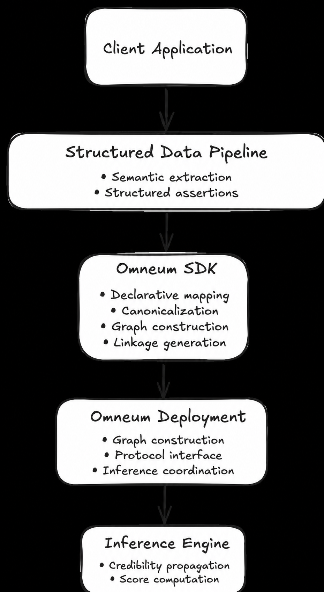

# Verity Architecture

This document provides a high-level overview of the Verity architecture and defines its fundamental components and their interactions.

To see related specifications, visit:

- **[`protocol.md`](../protocol/protocol.md)** — the communication contract between clients and Verity deployments. Defines the JSON-RPC protocol and request & response formats.
- **[`canonicalization.md`](../protocol/canonicalization.md)** — deterministic normalization rules. Specifies how semantically equivalent assertions produce the same graph representation before evaluation.
- **[`sdk.md`](../protocol/sdk.md)** — client integration guides for constructing graphs, linkage token generation, submitting requests from supported languages.

## 1. Objectives

Verity is a Data Trust Gateway for Agentic Systems. It evaluates structured
assertions collected from multiple sources and returns deterministic
information-quality signals.

A major goal for Verity is to enable integration with existing structured data pipelines, regardless of application domain, programming language, or deployment environment used.

The architecture is guided by several core design principles:

- Semantic extraction is separated from assertion evaluation.
- Deterministic graph construction through standardized canonicalization.
- Privacy-preserving linkage through deterministic cryptographic tokens instead of the underlying application data.
- Producing deterministic source-reliability and claim-support signals from graph topology.
- Deployment through standard protocol interfaces such as MCP.
  
## 2. System Overview

At the highest level, Verity is composed of three key architectural components:

- Verity SDK
- Verity Deployment
- Assertion Evaluation Engine

Applications can install and integrate the Verity SDK directly into their structured data pipelines. The SDK performs deterministic canonicalization, serializes canonical values, executes the privacy-preserving linkage protocol to generate linkage tokens, constructs a complete request-scoped assertion graph, and submits it to a Verity deployment.

A Verity deployment receives a complete opaque graph in each request, evaluates
the assertions without retaining the graph, and returns source reliability,
claim support, dependency telemetry, conflicts, and convergence metadata.

  

  <em>Figure 1. High-level architecture of the Verity system.</em>

## 3. Architectural Components

### 3.1 Verity SDK

The SDK serves as the primary integration point between applications and a Verity deployment.

### 3.2 Verity Deployment

A deployment validates request-scoped assertion graphs, executes the assertion
evaluation engine, and returns information-quality signals.

### 3.3 Assertion Evaluation Engine

The assertion evaluation engine implements an iterative graph-propagation
method. Internally, it updates source reliability and claim support until the
source-reliability vector converges.

## 4. End-to-End Workflow

This section specifies how data flows through a Verity deployment, from creating structured assertions to receiving information-quality signals.

### 4.1 Structured Data Pipeline

A core principle of Verity is it does not analyze raw data. Applications collect and organize information from their own data sources. Some examples of data sources could include REST APIs, databases such as SQL, documents, spreadsheets, knowledge bases, MCP tools, or even the outputs of AI agents. The application should interpret the data and convert it to structured assertions before interacting with Verity.

The method used to perform semantic extraction is outside the scope of Verity.

### 4.2 Canonicalization

The Verity SDK applies deterministic canonicalization to structured assertions. The resulting canonical assertions are then deterministically serialized before privacy-preserving linkage tokens are generated. The canonicalization rules are defined in the Verity Canonicalization Specification.

### 4.3 Privacy-Preserving Linkage

After canonicalization, the SDK deterministically serializes canonical assertions and executes the standardized linkage protocol to generate privacy-preserving linkage tokens.

These linkage tokens are deterministic for equivalent canonical assertions while minimizing disclosure of the underlying assertion content.

The linkage protocol is specified separately from the system architecture.

### 4.4 Assertion-Evaluation Request Construction

The SDK constructs a complete assertion-evaluation request containing opaque
assertion triples, the numerical source-pair inputs required by the algorithm,
and the protocol metadata required by the Verity Protocol.

### 4.5 Request Submission

The request is transmitted to the reference deployment over local MCP stdio. Remote transport and Verity Cloud behavior are not implemented.

### 4.6 Assertion Evaluation

After submission, the deployment treats linkage tokens as opaque identifiers,
constructs the assertion graph, and executes the configured algorithm. It does
not reverse or resolve tokens to application content.

### 4.7 Evaluation Response

The deployment returns deterministic information-quality signals to the application.

## 5. Assertion Graph

Each evaluation request defines an assertion graph composed of the submitted
sources, claims, and assertions. The deployment constructs this graph before
executing dependency-adjusted reliability propagation.

### 5.1 Graph Structure

The assertion graph is modeled as a bipartite graph where source and claim
nodes connect through their assertions. The submitted assertions determine the
topology analyzed during evaluation.

### 5.2 Graph Construction

The deployment constructs the assertion graph directly from the submitted
opaque assertion triples. The graph exists only for the duration of the
request.

## 6. Deployment

### 6.1 Reference Implementation

The reference implementation is a local-stdio MCP server. It accepts complete
request-scoped graphs, evaluates assertions, and returns deterministic
information-quality signals according to the Verity Protocol.

### 6.2 Trust Boundary

Applications perform semantic extraction, canonicalization, and
privacy-preserving linkage before interacting with Verity. Verity operates only
on opaque linkage tokens and protocol metadata, never on the underlying
application content. This separation establishes the trust boundary between
application-specific processing and assertion evaluation.
